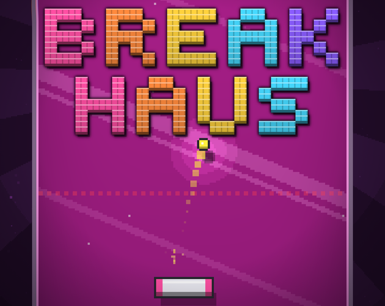

# Breakhaus on itch.io

The page's art, drawn by the game itself: the play screen in the
Penthouse's colours, the rays turning round it, without the HUD (rendered
by `src/debug/key_art.gd`), with the logo, the haus and the lettering as
the game draws them laid over it. The page is played in the browser, so
it is one column: the banner, the game's frame (960x640), then the text.



## What goes where

| File | Where on itch.io | Size |
| --- | --- | --- |
| `out/cover.png` | Edit game: **Cover image** | 630x500 (shown at 315x250 in listings) |
| `out/banner.png` | Edit theme: **Banner** | 1920x640, shown 960x320 across the top of the column |
| `out/background.jpg` | Edit theme: **Background** | 3440x1440, shown at its own size behind the column |
| `out/embed.png` | Edit theme: Visual customization, **Background Image** (behind the game's frame) | 960x640, the frame's size |
| `out/heading_*.png` | In the description, as images | 1840x112, shown 920 wide |
| `out/controls.png` | In the description, under Controls | 1840x744, shown 920 wide |

Screenshots and a trailer are made elsewhere (the game-screenshots and
game-trailer skills).

## The game's frame (Edit game, Embed options)

Played in the browser, **960 x 640** (the wide layout: the board as tall
as the frame, the haus and the score beside it). The README's portrait
720x1280 is taller than most laptop screens. Mobile friendly, with a
fullscreen button, suits it, with the mobile **Orientation** left on
**Default** (or Portrait): set to Landscape, itch turns a phone's full
screen sideways, and the game, which lays itself out for whatever shape
it is given, never gets to be tall.

## The theme (Edit theme, on the game's page)

- **Banner**: `out/banner.png`, centred.
- **Background**: `out/background.jpg`. Repeat: **No repeat**. Align:
  **Center**. **Fixed**: on (the art stays put as the page scrolls).
- **Colours**:

  | | |
  | --- | --- |
  | BG | `#1c0a22` (the page round the art; the art fades into it) |
  | BG2 | `#2a1235` (the column: the UI's panel), BG2 Alpha 100% (under More options) |
  | Text | `#fff4fb` |
  | Link | `#ff4fa3` |
  | Buttons | `#ff4fa3` |
  | Headers | `#ffd23d` |

- **Fonts**: **Rubik** for the page and **Bungee** for the headers (the
  game's own two, both on Google Fonts); text size Large.
- **Layout**: Screenshots **Auto** (hidden for a game played in the
  browser, which is what the headings' 920 width is made for).

All of it is in `theme.json` too, which the preview reads.

## The description

`description.html` is a draft of the page's text, written after GoreDash's
(which follows Olof's City Watch devlogs), with the heading images in
place of plain headings and `controls.png` for the controls. Change what
you like. In itch.io's editor, upload each image with the image button
where it goes.

## Building it again

```sh
python3 itch/tools/plates.py      # the game's pictures (itch/build/plates/)
python3 itch/tools/build.py       # lays out every piece into itch/out/
python3 itch/tools/preview.py itch/theme.json   # the page as itch.io shows it
```

`plates.py` runs the game once per picture, on a fixed clock with a
seed, so the same arguments give the same picture (all of them in a few
seconds). `--scene=keyart` is the play screen without its HUD: the board
placed and zoomed by `--board=`, the rays' hub by `--rays=`, the wall
brought down by `--wall=`, a smashed ball sent off by `--smash=`, pickups
hung by `--drop=`, `--empty` for no blocks (the cover's logo is its wall)
and `--bare` for just what is on the board. `--scene=logo`, `--scene=haus`
and `--scene=words` draw the logo, the HUD's haus and a line of the UI's
lettering on transparent. Each plate's arguments are at the top of
`plates.py`; `FLOOR` there picks the floor (and so the colours) for all of
them.

`build.py` shoots each page in `compose/` with headless Chrome at twice
the size itch.io shows it (`tools/shoot.py`; the background at its own
size), and checks it is under itch.io's 3 MB. The pages are plain HTML
and CSS over the game's pictures: `style.css` has the UI's colours, its
fonts and its rounded, lipped buttons. `build.py banner cover` builds just
those.

`preview.py` lays everything out as itch.io's own game page does (a 960
column, the column 600 wide under 1000 px) and shoots it at 1920, 1366 and
2560 wide, on a tablet and a phone, and the cover in a listing, into
`itch/build/preview/`. Look at those before uploading.

`itch/build/` is not kept in git; `itch/out/` is.
